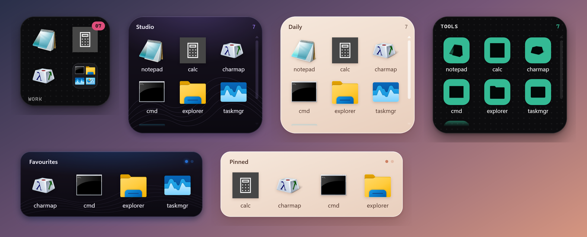
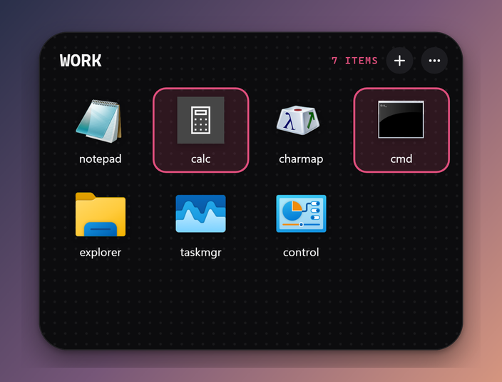
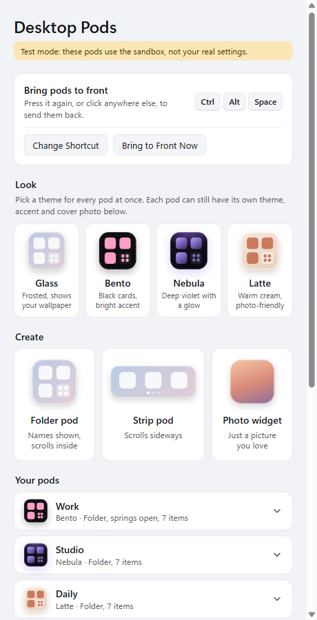

# Desktop Pods

Widget-style boxes on your Windows desktop that hold **links** to your files, folders and apps. Think iPhone App Library or home-screen widgets, but on Windows.

Your real files are never moved, renamed or deleted, and File Explorer keeps working exactly as before.



## Features

- **Four themes:** Glass (frosted wallpaper), Bento (black cards with one bright accent), Nebula (deep violet with a glow) and Latte (warm cream). Each pod can have its own theme and accent colour, or you can set one theme for all pods from the Hub.
- **Your own icons:** use any PNG, JPG, BMP or ICO as an item's icon. Shortcuts show the same icon Explorer shows (web apps, Store apps and programs included).
- **Cover photos and photo widgets:** put a photo behind a pod, or make a pod that is just a photo.
- **Three layouts:** a folder that scrolls inside, a folder that springs open into a grid, and a sideways-scrolling strip.
- **Matching tiles:** turns every icon into a one-colour glyph on an accent-coloured tile.
- **Stays where you put it:** lock a single pod or all of them, and pods snap into line while you drag. If a monitor or scaling change pushes pods around, they return to their spot later.
- **Add many files at once:** drag them from Explorer, multi-select in the add dialog, or use the opt-in **Send to → Desktop Pods** entry in Explorer.
- **Light on memory:** pods are drawn without the GPU by default (about 350 MB instead of 620 MB for four pods plus the Hub). You can switch this off in the Hub.
- **Hotkey:** Ctrl+Alt+Space (you can change it) brings all pods in front of your windows.

<p>
  
  
</p>

## Requirements

- Windows 10 or 11
- [Node.js](https://nodejs.org/) 20 or newer (only needed to install and run from source)

## Install

```
git clone <this repo>
cd desktop-pods
npm install
```

## Try it safely first (test mode)

```
npm run sandbox
```

- Settings go to `sandbox/data`, and `sandbox/FakeDesktop` holds dummy files to drag in.
- Test pods show a small yellow **Test** badge.
- Run `npm run sandbox:reset` to start over.
- Quit from the tray icon (bottom-right of the taskbar, possibly under the ^ arrow).

## Use it for real

```
npm start
```

Or double-click **`Desktop Pods.vbs`** to start it without a console window. Running it again while Pods is open just opens the Hub.

Settings live in `%APPDATA%\Desktop Pods\pods.json`, and a `.bak` copy is kept automatically. Custom icons and covers live in `images\` next to it. Pods does **not** start with Windows unless you set that up yourself.

## How to use

| Do this | What happens |
| --- | --- |
| Click an icon | Opens that file or app |
| Drag a pod | Moves it (snaps to other pods and the screen edge) |
| Drag the bottom-right corner | Resizes it |
| Drag files from Explorer onto a pod | Adds links to them |
| Ctrl+click, Shift+click, Ctrl+A | Selects several items; right-click one to open, move, re-icon or remove them all |
| Right-click an item > **Change Icon…** | Uses your own picture (shrunk to 256 px and stored once) |
| Right-click > **Theme**, **Accent Colour**, **Icon Style** | Changes the look of that pod |
| Right-click > **Cover Photo…** | Puts a photo behind the pod |
| Right-click > **Style** | Folder (scrolls inside), folder (springs open), or strip |
| Right-click > **Lock Position and Size** | Stops this pod from moving |
| F2 | Renames the focused item (or the pod) |
| Esc | Clears the selection, then closes an open pod |
| **Ctrl+Alt+Space** | Brings all pods in front of every window; press again or click away to send them back |
| Tray icon > **Open Hub** | All settings: themes, new pods, lock all, snapping, low memory mode, Send to |

## Privacy and safety

- Pods only store paths. They never copy, move or change your files.
- Everything stays on your computer. Nothing is sent anywhere.
- The only change outside the app's own settings folder is the optional **Send to** shortcut in `%APPDATA%\Microsoft\Windows\SendTo`, which you turn on (and off) in the Hub.

## Development

```
npm test            # unit tests (node:test)
npm run test:e2e    # launches the real app against a temp folder and drives it with Playwright
```

The end-to-end test never touches your real pods: it uses a throwaway data folder and deletes it afterwards. It saves screenshots to `%TEMP%\pods-e2e-shots` (or `SHOTS_DIR`).

| Path | What it does |
| --- | --- |
| `src/main.js` | Electron main process: windows, menus, tray, hotkey, Hub, Send to |
| `src/store.js` | Config format, validation and atomic saves (with `.bak`) |
| `src/geometry.js` | Pod placement, clamping to the screen, snapping |
| `src/icons.js`, `src/shellimage.js` | Icons as Explorer draws them (via the Windows shell, through `koffi`) |
| `src/images.js` | Imports custom icons and covers, removes ones no longer used |
| `src/zorder.js` | Keeps pods behind normal windows like desktop widgets |
| `src/renderer/` | The pod window (one per pod) and its themes |
| `src/hub/` | The Hub settings window |

## License

[Apache License 2.0](LICENSE)
